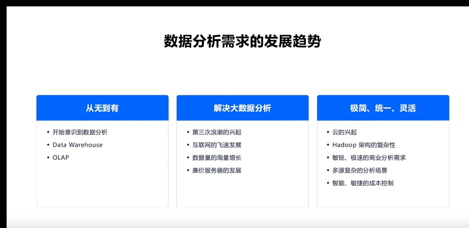
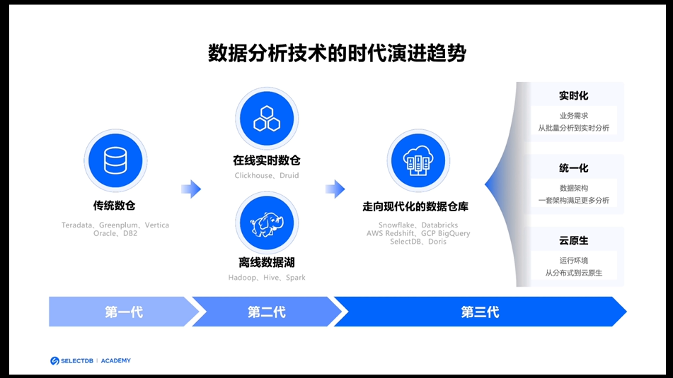
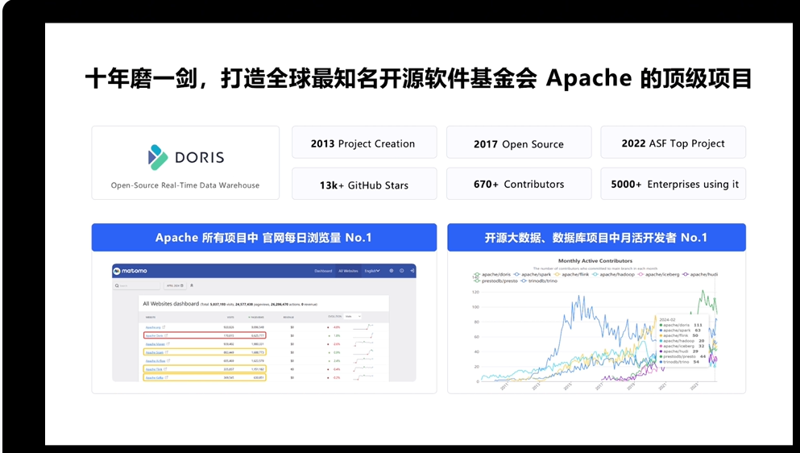
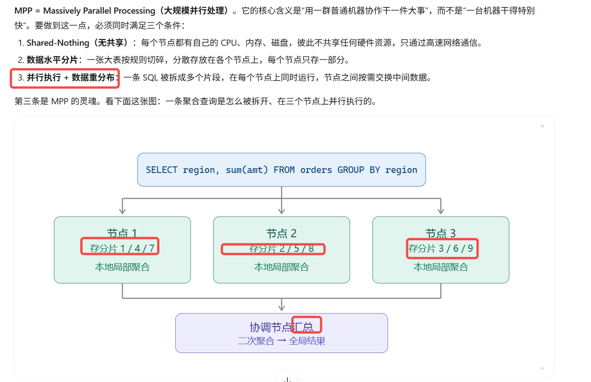
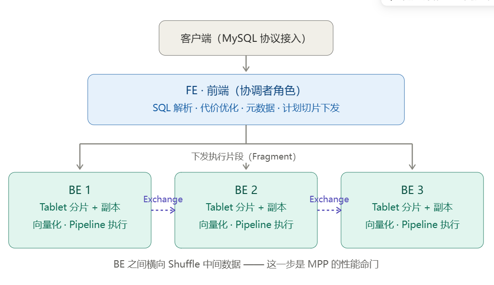
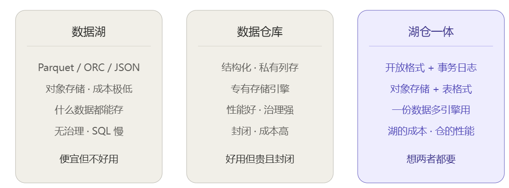

# 架构原理 · 学习笔记

::: tip 如何编辑本页
**最省事的方法**：打开[写笔记（网页版）](/guide/写笔记)——选主题、写正文、点保存，截图 Ctrl+V 直接粘贴，不用懂 Markdown。
也可以在编辑器里打开源文件 `docs/doris/01-架构原理/01-学习笔记.md` 手写。两种方式完全等价，可混用。
:::

> 规范：一篇笔记对应一个素材，二级标题格式「YYYY-MM-DD · 素材名（来源/时长）」。
> 翻译类笔记在开头注明原文链接；命令与关键操作用代码块实录。

## 2026-10-22 · 本站三节原理课（本站图文 / 约 35 分钟）

### 核心要点

- 数据库 = 有组织的数据 + 一个回答问题的引擎；Doris 是**分析型**（OLAP），擅长海量数据上的汇总统计
- **FE 管“想清楚怎么做”**：接请求（兼容 MySQL 协议）、生成执行计划、管元数据、管节点；**BE 管“真的去做”**：列式存储数据、执行计算
- FE 三角色：Master（写元数据）/ Follower（可参与选主）/ Observer（只读、分担查询）；元数据变更需**多数派确认**
- 数据摆放四层：表 → 分区（按时间切，管“好查好清理”）→ 分桶（Hash 打散，管“均匀与并行”）→ Tablet（物理分片，默认 3 副本）
- 两条设计经验：分区列优先选时间/低基数列；分桶列选高基数列（如 user_id）

### 命令与操作实录

```sql
-- 观察集群（只读命令，测试机/生产均可安全执行）
SHOW FRONTENDS;
SHOW BACKENDS;
SHOW CREATE TABLE 表名;
```

### 疑问与待验证

- [ ] 测试机的 FE 当前是不是 Master 角色？（→ 实验 1 验证）
- [ ] 生产集群实际有几个 FE、几个 BE？（→ 找时间只读查看确认）
- [ ] 我们生产的表分区列/分桶列是怎么选的？（→ 实验 2 解剖一张真实表）

---

<!-- ↓↓↓ 以后每学完一个素材，复制下面这段模板，改成新的一篇，追加到本文件末尾 ↓↓↓ -->

## 2026-10-28 · SelectDB 官方基础入门课（第一章 产品概述）

### 核心要点
#### 1. 总体介绍




-doris 2013年创建
Doris大部分用在实时数仓里面


doris可以支持高并发高吞吐的复杂场景


案例：


#### 2. 分区与分桶
Table ──► Partition ──► Bucket ──► Tablet（数据分片，存储在 BE 节点上）

一个分桶在物理上对应一个数据分片（Tablet），Tablet 是 Doris 中数据管理的最小单元，也是数据移动、复制等操作的基本物理单位。

Doris 集群由两类节点组成：
- FE 节点（Frontend）：管理集群元数据（如表、分片信息），负责 SQL 的解析与执行规划；
- BE 节点（Backend）：存储 Tablet 数据，负责计算任务的执行；BE 的结果汇总后由 FE 返回给用户。


### 命令与操作实录

```sql
-- 在此粘贴本素材涉及的关键命令
```

### 疑问与待验证

- [MPP ]：大规模并行处理，doris是标准的MPP架构

关键在“局部聚合”这一步：每个节点只算自己那部分数据，产生中间结果，再汇总。所以 3 台机器扫同样的数据量，理论耗时接近 1/3，这就是 MPP 的线性加速来源。注意它加速的是扫描和计算，不是“把一条 SQL 拆成三条分别查三个库，再手动把结果拼起来”，那是应用层的分库分表，不是 MPP。


-[湖仓一体]：数据湖是把原始文件直接放进对象存储（S3/OSS/HDFS），格式开放（Parquet/ORC/JSON），成本极低、什么数据都能放，但缺乏治理、SQL 性能差，很容易变成“数据沼泽”。
数据仓库是结构化数据进专有格式，schema 先定好，性能强、治理完善，但贵、封闭，且只吃得下结构化数据，AI/机器学习用不上里面的数据。

“一体”合的是什么
传统做法是湖和仓并存：原始数据放湖里，再 ETL 一份进仓，供 BI 查询。代价是数据存两份、链路有延迟、元数据和权限各管一套、口径容易不一致。

湖仓一体的思路是：在对象存储的开放文件之上，加一层“表格式”，让湖上的数据具备仓库才有的能力：ACID 事务、快照与时间旅行、schema 演进、并发读写不冲突。


<!-- ↓↓↓ 以后每学完一个素材，复制下面这段模板，改成新的一篇，追加到本文件末尾 ↓↓↓ -->

## YYYY-MM-DD · 素材名（来源/时长）

### 核心要点

-

### 命令与操作实录

```sql
-- 在此粘贴本素材涉及的关键命令
```

### 疑问与待验证

- [ ]


