# 部署与变更 · 学习笔记

> 规范：一篇笔记对应一个素材，二级标题格式「YYYY-MM-DD · 素材名（来源/时长）」。
> 翻译类笔记在开头注明原文链接；命令与关键操作用代码块实录。


## 2026-11-07 · selectDB 官方视频 第二章节部署 部署前提

### 核心要点
#### 1. 部署目录结构
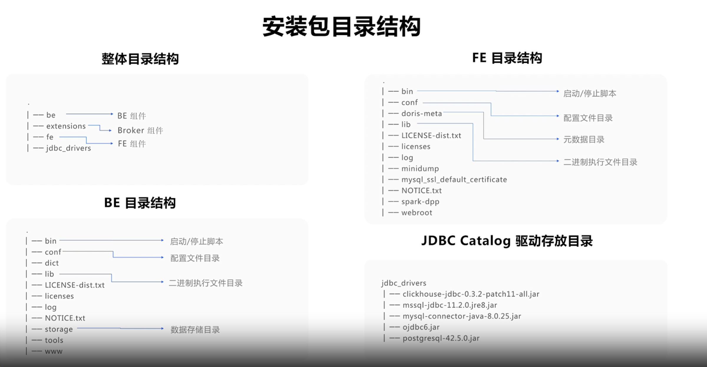
FE doris-meta生产环境建议放在ssd磁盘
BE storage目录是数据存储目录，生产环境需要单独的ssd的磁盘挂载

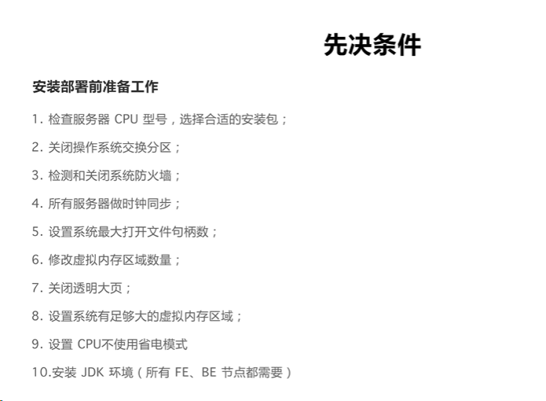
3个FE最大的容忍时间差是5s
系统最大打开文件句柄数，生产建议设置为10000

#### 2. 手动部署

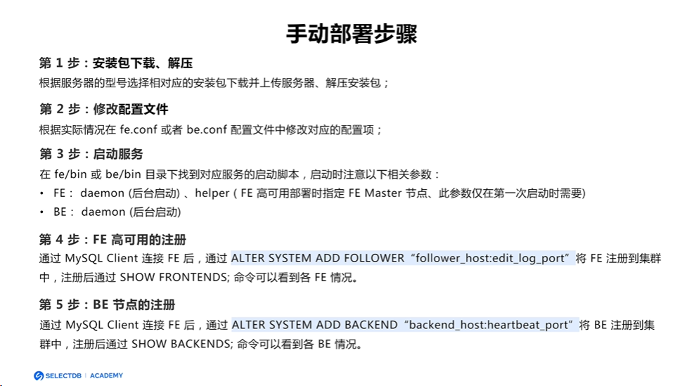
FE --helper 在第一个节点启动的时候不需要，后面follower和observer节点需要加

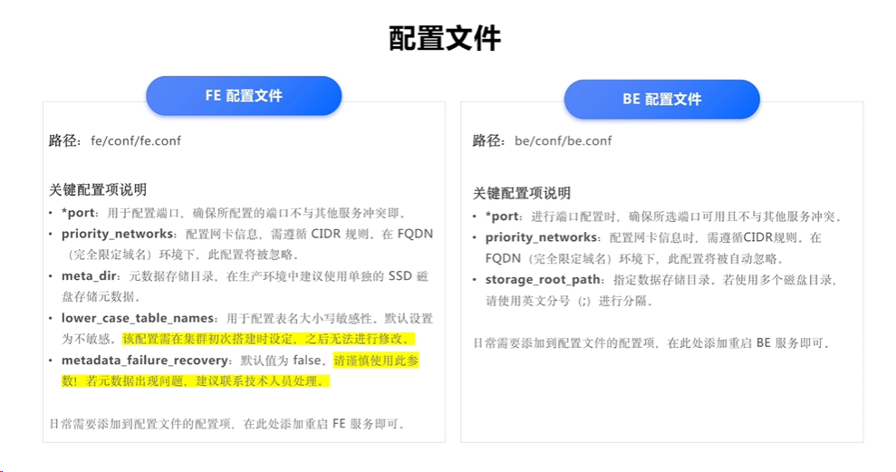

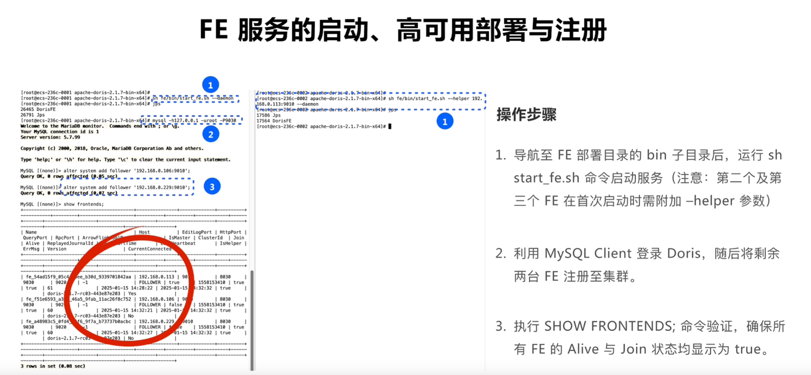
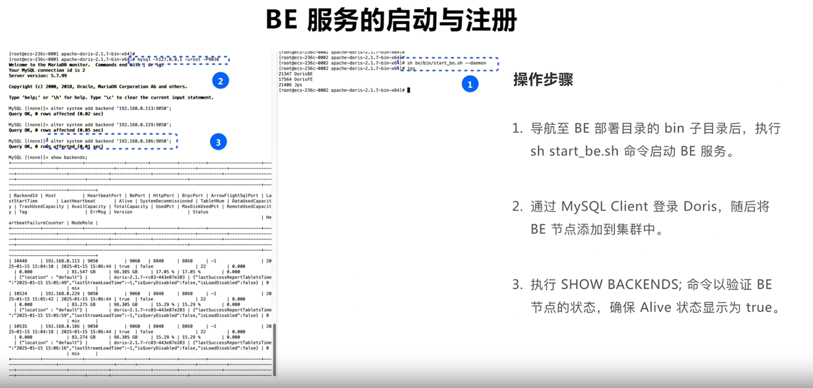
通过alter system把BE节点添加进来，然后才能用show backends来看

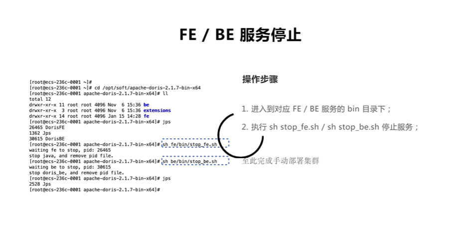

#### 3. 通过manager来部署doris集群
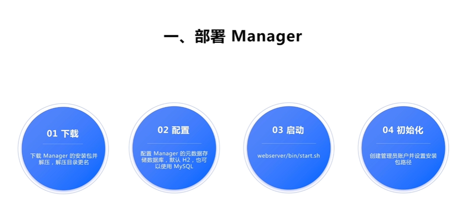
doris和manager的安装包的路径
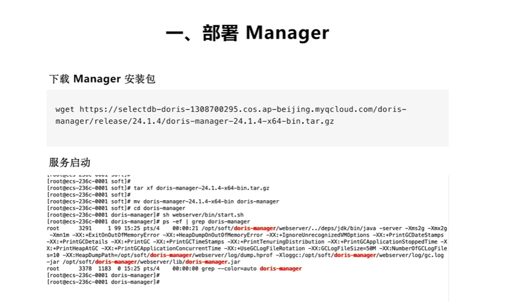
安装完成后，默认端口是8004，可以在浏览器打开
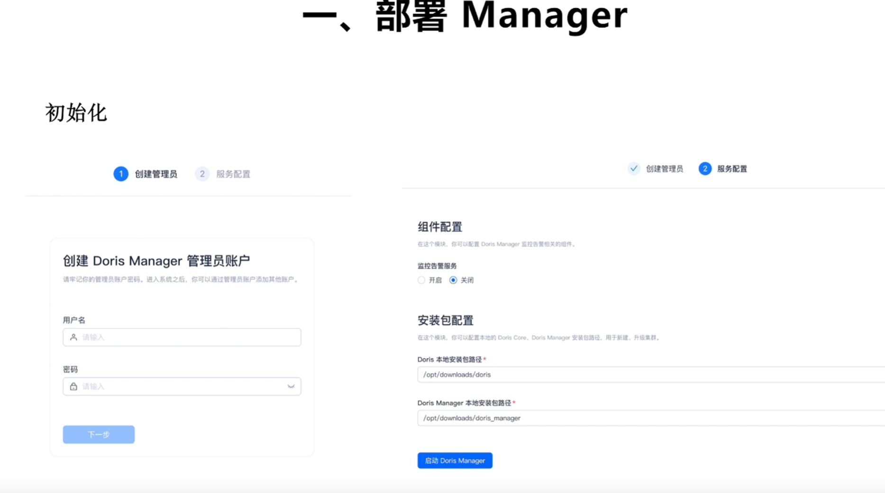

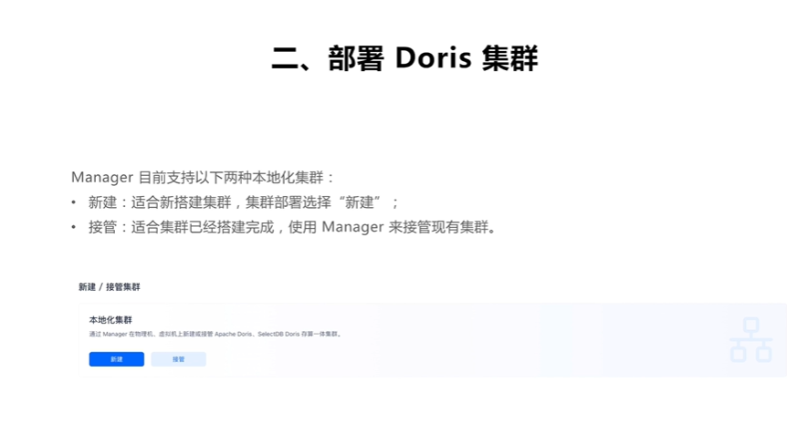
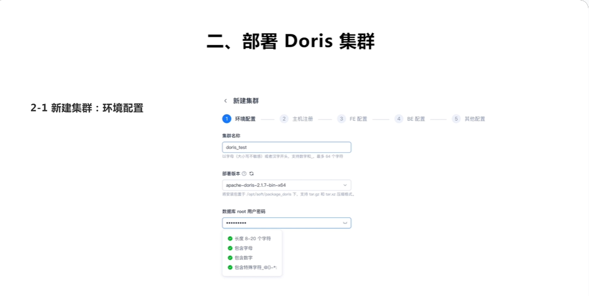
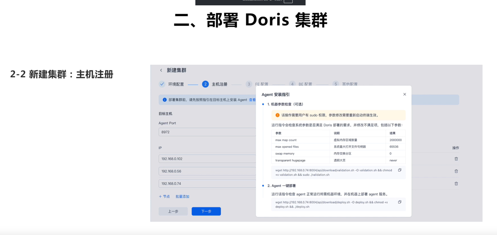
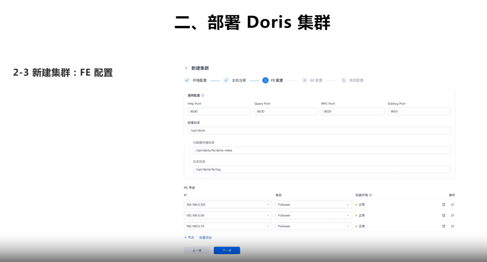
元数据存储目录需要做单独存储
日志目录也需要配置

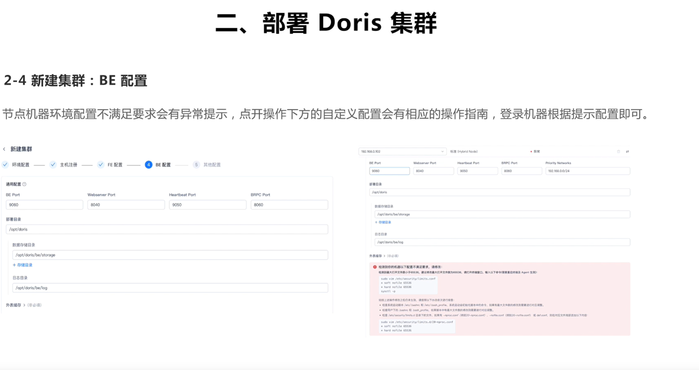
数据存储目录
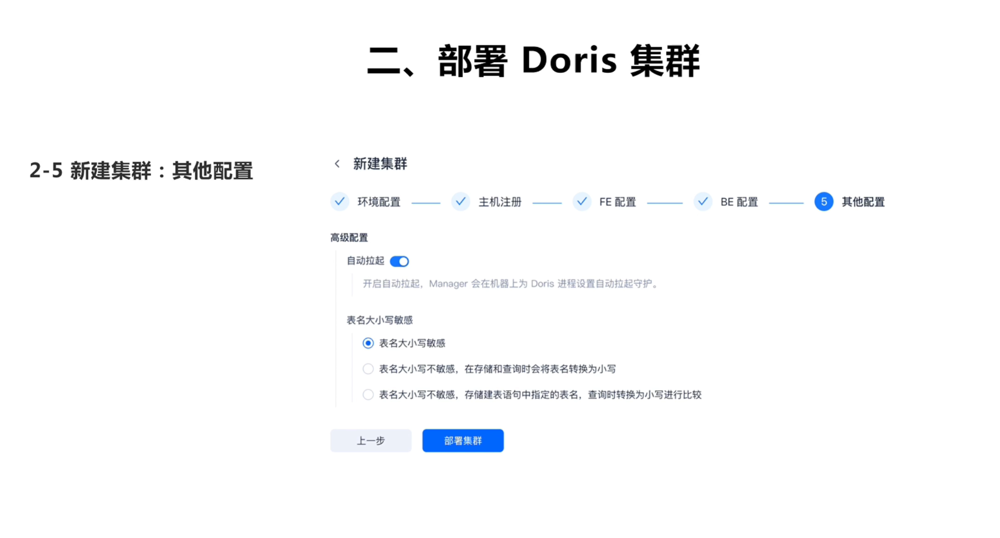
表名大小写需要集群创建的时候进行配置
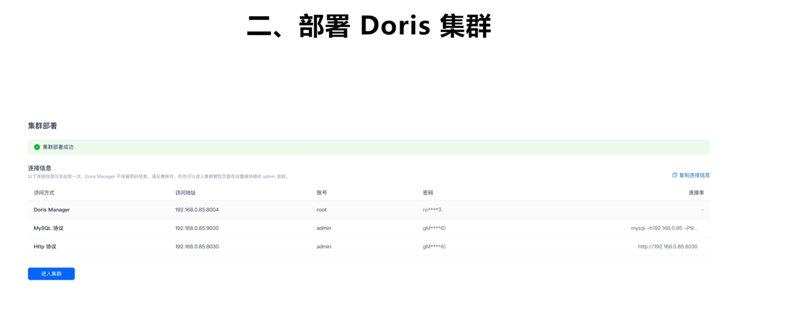

#### 4. 连接doris集群
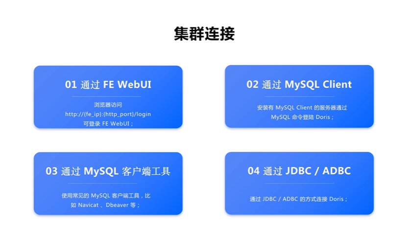
fe web url，需要有admin权限的账号
#### 总结
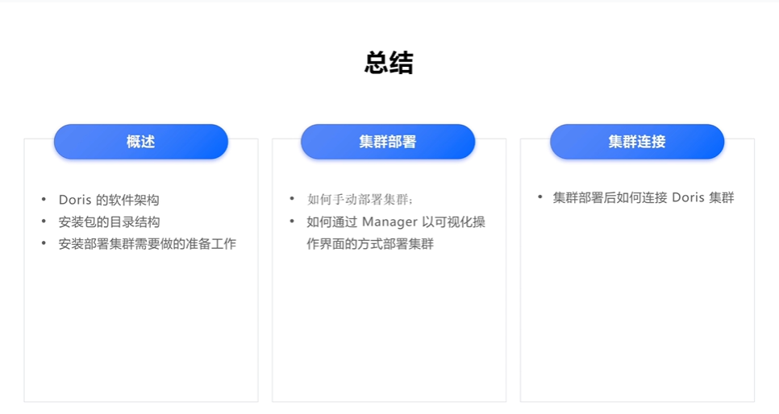


-

### 命令与操作实录

```sql
-- 在此粘贴本素材涉及的关键命令
```

### 疑问与待验证

- [ ]

## 2026-11-10 · 手动部署，selectdb官方视频

### 核心要点


-

### 命令与操作实录

```sql
-- 在此粘贴本素材涉及的关键命令
```

### 疑问与待验证

- [ ]


## YYYY-MM-DD · 素材名（来源/时长）

### 核心要点

-

### 命令与操作实录

```sql
-- 在此粘贴本素材涉及的关键命令
```

### 疑问与待验证

- [ ]
